# Sync Scenarios

This doc walks through the interesting mirror/sync states swarf can land
in, and what we want to happen vs. what currently happens. The goal is
to verify each scenario is handled correctly — when one isn't, the
"Currently" line points at the bug.

> **Status as of 2026-09-28.** The work in [Sync Hardening](SYNC_HARDENING.md)
> (tasks 1–5) has landed. The **stale-manifest mid-life** failure mode —
> manifest already records N files, project then loses some or all of
> them between passes — is fixed by the delete hold (Scenarios 6, 7, and
> 8). The reverse mirror no longer deletes project files it has never
> seen synced, the sync lock serializes push, pull, and the daemon cycle
> (Scenario 5), `swarf pull --resync` recovers a store that already lost
> files, and the owner token stops two machines sharing a `machine_id`
> from overwriting each other (Scenario 12). Still open: retiring a peer
> (Scenario 10) and a regression test for manifest corruption
> (Scenario 11).
>
> *Earlier status (2026-05-15):* commit `70fc2ea` (manifest-tracked
> forward mirror) closed the **first-run** failure mode — with no
> manifest, the forward mirror does no deletes — but left the
> stale-manifest case live.

## Vocabulary

- **project** — `~/code/<repo>/swarf/` on this machine (the user-facing dir)
- **store** — `~/.local/share/swarf/<slug>/` (local backup, a git repo)
- **manifest** — `~/.cache/swarf/manifests/<slug>.txt`, the set of files
  swarf last observed in *this machine's* project on the previous tracked
  pass (written by `mirror.TrackedDir`)
- **peer cache** — `~/.cache/swarf/peers/<peer>/`, an `rclone sync`
  target of another machine's full store mirror
- **forward mirror** — project → store (`mirror.TrackedDir`, deletes
  propagate only via the manifest)
- **reverse mirror** — store → project (`mirror.TrackedReverse`: a
  project file missing from the store is deleted only when the manifest
  lists it; afterwards the manifest is rewritten to the project's file
  set. Before Sync Hardening task 2 this was the destructive `mirror.Dir`,
  which deleted anything in the project missing from the store)
- **sync exclude** — a glob from `[sync] exclude` in `config.toml`,
  matched against a drawer-relative path (`mirror.SkipPatterns`). An
  excluded path lives in the project only: it is never copied to the
  store, never watched, and never counted as pending
- **delete hold**, **hold marker**, **resync**, **owner token**,
  **sync lock** — coined in [Sync Hardening](SYNC_HARDENING.md#terms-introduced-by-this-plan)
  and defined there; used below in the same sense

## The two mirror functions

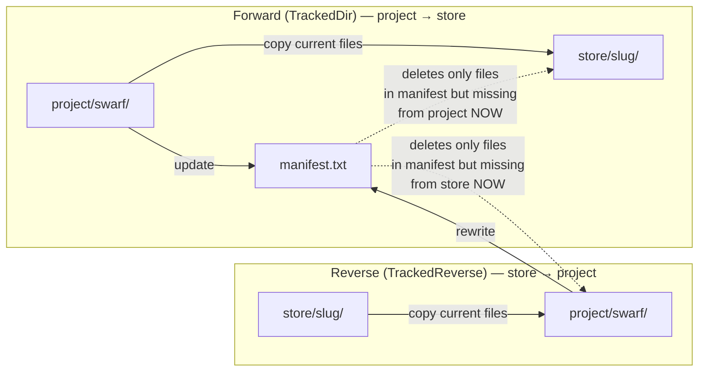

Both directions gate deletes on the same manifest: a file is deleted
only when swarf has seen it synced. (The reverse mirror used to be
destructive — anything not in the store was removed from the project —
until [Sync Hardening](SYNC_HARDENING.md) task 2.)

Three call sites use `TrackedDir`:
- `internal/daemon/runner.go:mirrorAllProjects` (every debounce)
- `internal/push/push.go:Run` (on `swarf push`)
- `internal/pull/pull.go:mirrorProjectsToStore` (start of `swarf pull`)

One call site uses `mirror.TrackedReverse`:
- `internal/pull/pull.go:mirrorStoreBackToProjects` (end of `swarf pull`)

### Sync excludes cut across both directions

Every one of those four call sites passes the same
`mirror.SkipPatterns(gc.Exclude)`, and it has to be all four. The forward
mirror is only half of an exclude:

- **Forward** — an excluded path is not copied, and if the manifest says
  we used to copy it, the ordinary manifest delete pass prunes it from the
  store. That is what takes it off the remote as well, since the store is
  what `rclone sync` uploads.
- **Reverse** — the same Skip has to suppress the *delete* pass. The store
  has no copy of an excluded path by design, and the reverse mirror
  deletes manifest-listed files the store lacks, so without the Skip the
  first `swarf pull` after adding an exclude would delete those files out
  of the project. Excluding a directory would destroy it.

Two non-mirror consumers follow from the same rule: the daemon does not
watch excluded subtrees (`addRecursive`, `isExcluded`), and `swarf status`
does not count excluded files as pending (`mirror.PendingFiles`).

What an exclude does **not** do is rewrite history. Content already
committed to the store stays in `.git` and keeps being pushed; getting it
out of the store's history is a separate, one-time `git filter-repo`
operation.

## Scenario 1: User edits a file in project

**Want:** edit propagates to store, then to remote, then to peers on their next pull.

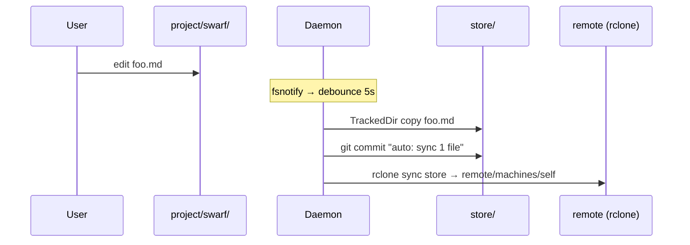

**Currently:** ✅ works. Manifest gets updated to include `foo.md`,
forward mirror copies, daemon's `backend.Sync` pushes.

## Scenario 2: User deletes a file in project

**Want:** delete propagates to store and remote.

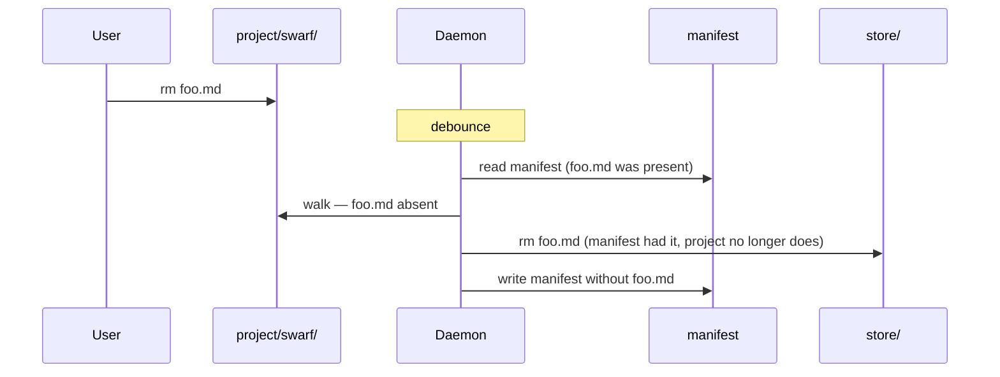

**Currently:** ✅ works. The manifest gating is exactly what makes this safe.

## Scenario 3: First-ever run on this machine, project/swarf/ is empty

**Want:** no destructive action — manifest doesn't exist, nothing to delete from store.

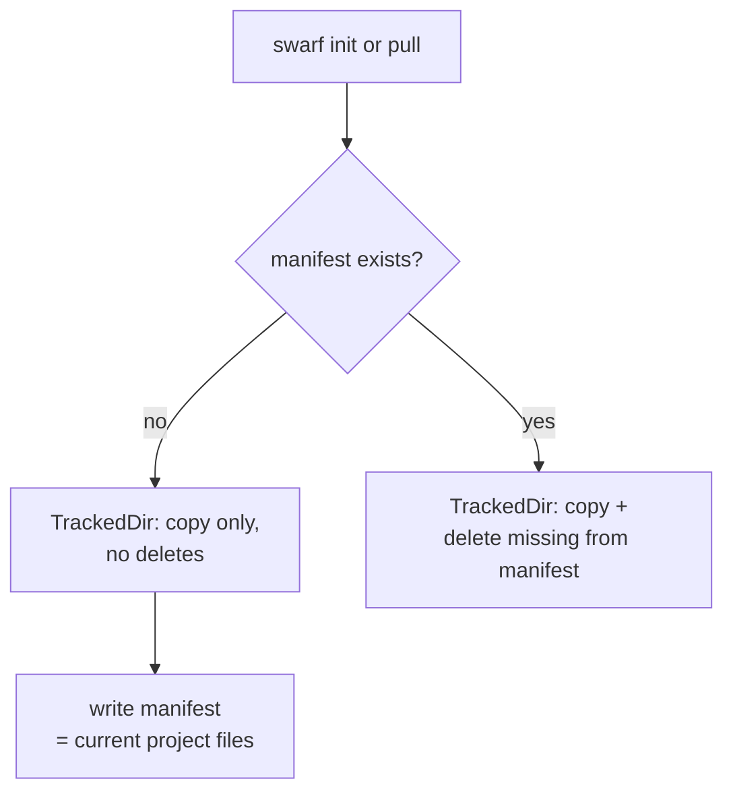

**Currently:** ✅ works. `readManifest` returns an empty set when the
file is absent, so the delete loop in `TrackedDir` has nothing to act on.
Locked in by `TestTrackedDirWithoutManifestDeletesNothing` (mirror package) and
`TestMultiMachine_EmptyProjectDoesNotWipeStore` (integration).

## Scenario 4: Pull from a peer that has files we don't

**Want:** peer files land in *both* the local store *and* the project.

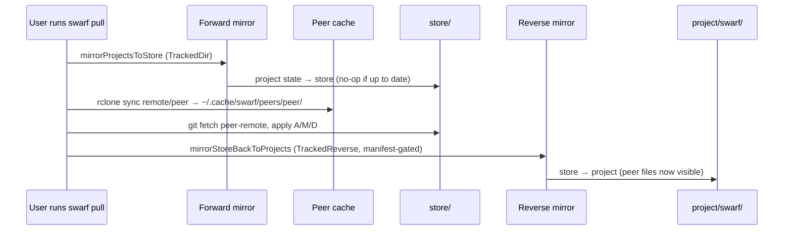

**Currently:** ✅ works in the common case. Tested by
`TestMultiMachine_AEditsPushes_BInits`,
`TestMultiMachine_BInitsFirst_ThenPullsA`,
`TestMultiMachine_RoundTrip`. The race window with the daemon (Scenario 5)
is closed by the sync lock. A file saved while pull downloads peers
survives the reverse mirror (`TestMultiMachine_FileSavedDuringPullSurvives`,
`TestPullKeepsProjectEditsMadeDuringDownload`), and if the peer changed
that same file its version becomes a conflict sidecar
(`TestPullSidecarsPeerChangeToFileSavedDuringDownload`).

## Scenario 5: Daemon is running while user runs `swarf pull`

**Want:** they don't fight. Either the daemon's forward mirror or
pull's forward mirror runs first; the result converges.

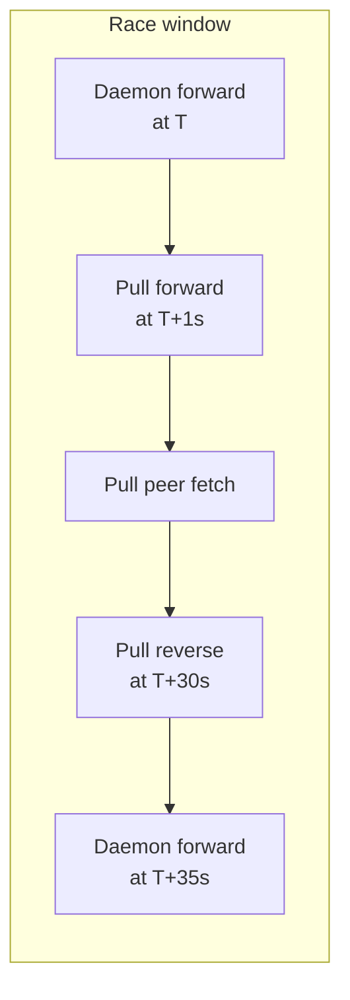

**Currently:** ✅ fixed by the sync lock (Sync Hardening task 4). Push,
pull, and each daemon cycle hold an `flock(2)` on
`~/.cache/swarf/sync.lock` for their whole run, so none of the
interleavings below can happen any more: a daemon cycle whose debounce
fires during a pull waits for the pull to finish, then runs its forward
mirror against the project pull left behind. A CLI push or pull that
finds the lock held prints a wait message and waits. Scheduled pulls
(`[sync] pull_interval`) take the same lock. Locked in by
`TestMultiMachine_PushWaitsForRunningPull`,
`TestMultiMachine_PullWaitsForRunningPush`,
`TestSyncCycleWaitsForSyncLock`, `TestSyncCycleHoldsSyncLockUntilDone`,
and `TestAcquireExcludesSecondHolder`.

*Analysis from before the lock, kept for the record.* With the manifest
in place, two interleavings were worth thinking about:

- **Daemon's forward fires during pull's reverse mirror.** Pull just
  wrote 50 of 693 files to project/swarf when the daemon's debounce
  trips. Daemon's `TrackedDir` reads project/swarf at this transient
  point, sees 50 files, the manifest from the prior cycle had (say) 0,
  newSet = 50 → no deletes against the store, manifest = 50. Reverse
  mirror finishes writing the remaining 643 files. Next daemon cycle
  picks them up cleanly. **Probably fine.**
- **Daemon's forward fires after pull's forward but before reverse.**
  Project at this moment is whatever it was when pull started. If pull's
  forward already updated the manifest to that state, daemon's
  `TrackedDir` is a no-op. Then pull's peer fetch runs, then reverse
  mirror writes 693 files. **Probably fine.**

The risk is subtler: if the daemon and pull both call
`writeManifest` concurrently, the second writer wins and the file
content depends on which `WalkDir` instance it reflects. A test that
intentionally interleaves the two calls would tell us whether that's
real.

## Scenario 6: Project files vanish between daemon passes (the 2026-05-12 bug)

This is what bit us on 2026-05-12. Reconstructed from `daemon.log`.

**Setup:** A previous pull seeded `~/code/forms/swarf/` with 693 files
from peer `matt-schulkind-3wny6v`. `TrackedDir` recorded all of them in
the manifest.

**Trigger:** Between daemon passes (23:06:36 → 01:16:00 — a 2h10m
window), 693 files vanished from `~/code/forms/swarf/`. Most likely
cause: a worktree cleanup, a stray `rm -rf`, a containerized process
deleting a mounted directory, or a separate `swarf pull` that ran
forward-mirror against an already-stale project.

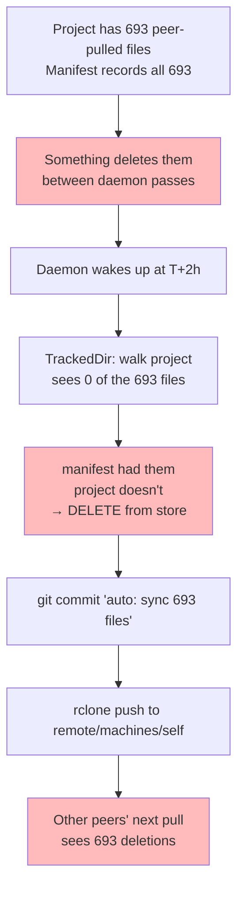

**The bad assumption:** "manifest says we had it, project doesn't, so
the user deleted it." This is wrong when the project itself is in a
broken/incomplete state — `TrackedDir` can't tell "user deleted 1 file"
apart from "something wiped 693 files."

**What `swarf status` showed afterwards:** 949 files locally, 3733 on
remote — the local store had been pruned, the other peer's full mirror
on remote was untouched.

**Recovery path:** the per-peer cache at `~/.cache/swarf/peers/<peer>/`
is *not* affected by local manifest logic — it's a one-way `rclone
sync` target. So the data is recoverable from there even after the
local store is pruned, as long as the peer cache hasn't been
re-synced from a remote that already lost the files.

**What changed since the original incident:** commit `70fc2ea`
introduced `TrackedDir` so the *first* pass (no manifest) doesn't
delete. That fix handles the "fresh machine" subcase. It does **not**
help once the manifest is populated.

**Currently:** ✅ fixed by the delete hold (Sync Hardening task 1).
Before deleting anything, `TrackedDir` counts the manifest entries that
are missing from the project and still exist in the store (sync
excludes left out). If the project lost every tracked file and at least
2 are at stake, or at least 10 are at stake and they are at least half
the manifest, the pass applies none of the deletes: adds and edits
still copy, the held paths stay in the manifest, and the hold marker
`~/.cache/swarf/delete-holds/<slug>.json` records the count, a sample,
and the first-seen time. The daemon logs the hold once; `swarf status`
and `swarf doctor` show it with the two ways out — `swarf pull` (copies
the files back from the store and clears the hold) or
`swarf push --allow-deletes`. The 693-file wipe above would now hold.
Locked in by `TestMultiMachine_WipedProjectHoldsDeletes`,
`TestMultiMachine_AllowDeletesAppliesHeldDeletes`,
`TestMultiMachine_HoldClearedByPeerDeleteIsNotRestored`,
`TestDeleteHoldLoggedOnce`, and the unit tests in
`internal/mirror/hold_test.go` and `internal/deletehold`.

For a machine whose store had already lost files before the hold
existed (or that confirmed a mass delete by mistake),
`swarf pull --resync` unions every file each peer currently has back
into the store (`TestMultiMachine_ResyncRestoresDivergedStore`).

### Mitigations to design for

*The design sketch below predates the fix. What shipped differs: the
thresholds are "every tracked file (at least 2)" or "at least 10 and at
least half"; the marker is called a hold marker; the recovery command
is `swarf pull` (restore) or `swarf push --allow-deletes` (confirm),
with `swarf pull --resync` for a store that already lost files. The
heartbeat manifest was not built.*

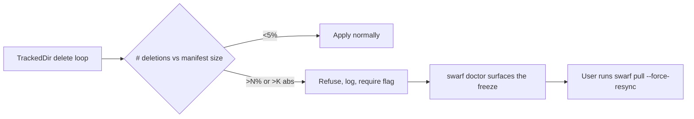

Two thresholds worth considering:
- **Sanity guard** in `TrackedDir`: if deletions > 25% of manifest *and*
  > 50 files, refuse and log a warning. The daemon writes a quarantine
  marker; `swarf status`/`doctor` surface it. User must run an explicit
  recovery command to acknowledge.
- **Heartbeat manifest**: record the project mtime + file count
  alongside the manifest. If the count drops by more than X between
  passes, treat as suspect.

## Scenario 7: Pull's forward-mirror clobbers the store before fetching peers

**Want:** pulling from a peer never makes things *worse* than before pulling.

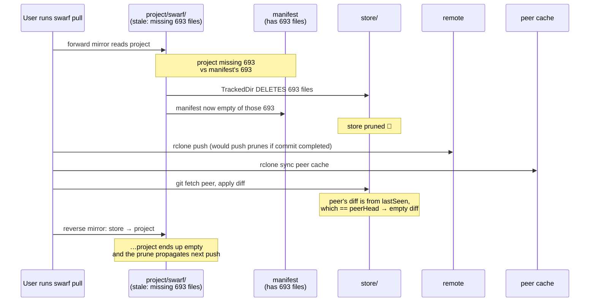

**Currently:** ✅ fixed by the delete hold. Pull's forward mirror is
the same `TrackedDir` pass, so a stale project that would lose every
tracked file (or a mass share of them) holds instead of pruning the
store; pull then fetches peers and its reverse mirror copies the held
files back from the store, which clears the hold.
`TestMultiMachine_WipedProjectHoldsDeletes` runs exactly this: a pull
from a wiped project with a populated manifest restores every file.

*Analysis from before the fix.* `pullRclone` called
`mirrorProjectsToStore()` unconditionally, *before* fetching peer
state. The post-`70fc2ea` behavior:

| State at start of pull                                | Forward mirror result        | Outcome |
|-------------------------------------------------------|------------------------------|---------|
| No manifest (first run, fresh machine)                | No deletes                   | ✅ safe (Scenario 3) |
| Manifest = N files, project = same N files            | No deletes                   | ✅ safe (idle case) |
| Manifest = N files, project missing K of them         | K deletes against the store  | 🔴 the bug (now held when K is a mass delete) |

The middle column is what `TrackedDir` fixed. The right column is what
the user originally reported — and it's still live.

The justification in the source is *"a manual `swarf pull` shouldn't
lose work the user just saved"* — but that's a false trade. The work
the user "just saved" is also visible to the daemon and would have
been pushed on its next debounce. Pull running forward-mirror is a
nice-to-have at best and a foot-gun at worst.

**Fix candidates:**
1. **Don't forward-mirror inside pull.** Daemon already handles
   project→store on its own schedule. Pull becomes read-only against
   the project until the reverse step. Lowest risk, smallest diff.
2. **Skip forward-mirror if it would be a mass delete.** Use the
   sanity guard from Scenario 6.
3. **Forward-mirror only changed files since last manifest write,
   never deletions.** Pull is then strictly additive on the project
   side.

~~Recommendation: **(1)**. The daemon does this work; pull doing it
again is a duplication that introduces risk without buying anything.~~

**Withdrawn** (see [Sync Hardening](SYNC_HARDENING.md#what-changed-from-the-earlier-recommendation)).
The reverse mirror at the end of a pull deletes project files that are
not in the store, so without the forward mirror a file saved moments
before a pull — before the daemon's debounce fired, or with no daemon
running — would never reach the store and would be deleted from the
project. `TestMultiMachine_LocalEditSurvivesPull` pins that case. The
forward mirror stays in pull; candidate **(2)**, the delete hold, is
what shipped, and the reverse mirror now deletes only files the
manifest lists (Sync Hardening task 2).

## Scenario 8: User deletes the entire project/swarf/ directory by accident

**Want:** the next forward pass should NOT wipe the store.

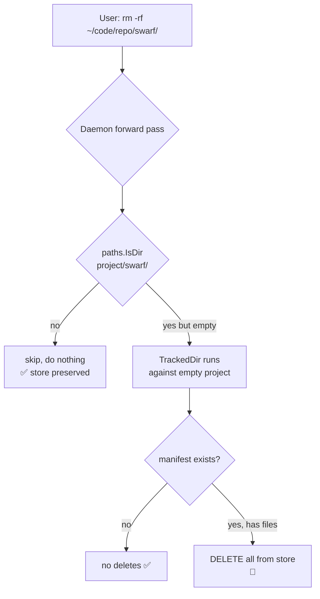

**Currently:** ✅ for the "directory removed" case —
`mirrorAllProjects` in `runner.go` skips when `paths.IsDir(src)`
is false. ✅ for the "directory still exists, never had content"
case — manifest is absent. ✅ for the "directory still exists, used
to have content, now emptied" case — the delete hold's "every tracked
file" rule holds it as soon as at least 2 files are at stake (a
one-file project losing its file is an ordinary delete).
Locked in by `TestTrackedDirHoldsWhenProjectLosesEveryFile` and
`TestTrackedDirSingleFileDeleteDoesNotHold`.

## Scenario 9: Two machines edit the same file between pulls

**Want:** swarf detects the conflict, writes a sidecar, doesn't silently lose either edit.

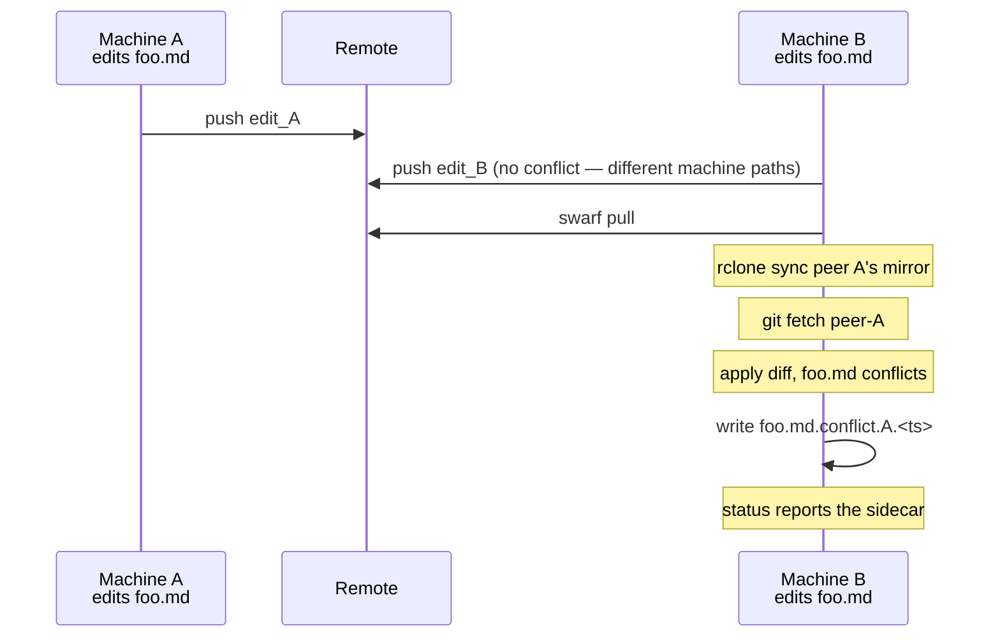

**Currently:** ✅ works for content-level conflicts; produces a
`.conflict.<peer>.<ts>` sidecar. Resolution is manual: edit the original,
delete the sidecar. Documented in `swarf docs conflicts`. Locked in by
`TestPullMultiPeerConflict` and `TestMultiMachine_ConflictingEdits`.

## Scenario 10: A peer disappears (machine retired)

**Want:** dead peer doesn't keep injecting old state into other machines.

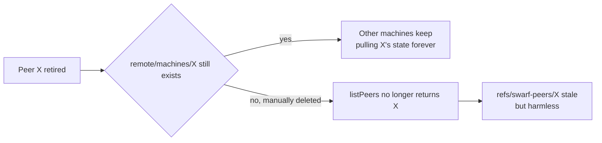

**Currently:** ⚠️ unverified. There's no UX for "decommission a peer."
The `refs/swarf-peers/<peer>` ref tracks last-seen, but if a peer's
remote dir is never deleted, its frozen state keeps showing up. Out of
scope for Sync Hardening; still open.

## Scenario 11: Manifest corruption / partial write

**Want:** a corrupt manifest never causes mass delete; the safe failure mode is "no deletes this pass."

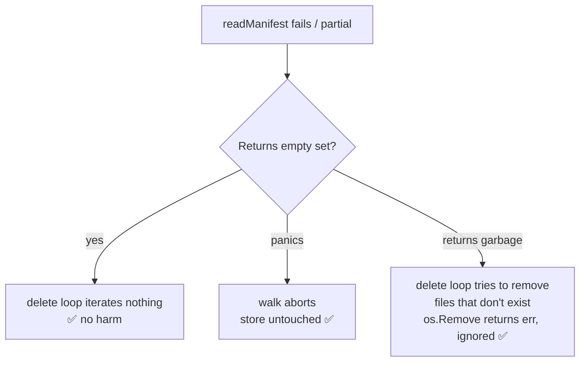

**Currently:** ✅ defensive by accident. `readManifest` returns an
empty map on any read error. `os.Remove` errors are swallowed. Worth a
test to lock this in; still none. The delete hold adds a second line of
defense: a garbage manifest that lists many files the project lacks
but the store has would hold rather than delete.

## Scenario 12: Bringing up a second computer (the user's current scenario)

**Want:** on machine B with config pointing at the same remote as A,
the documented flow (`swarf init` in the project, then `swarf pull`)
ends with B's store and remote subtree both fully populated, and A's
remote subtree untouched.

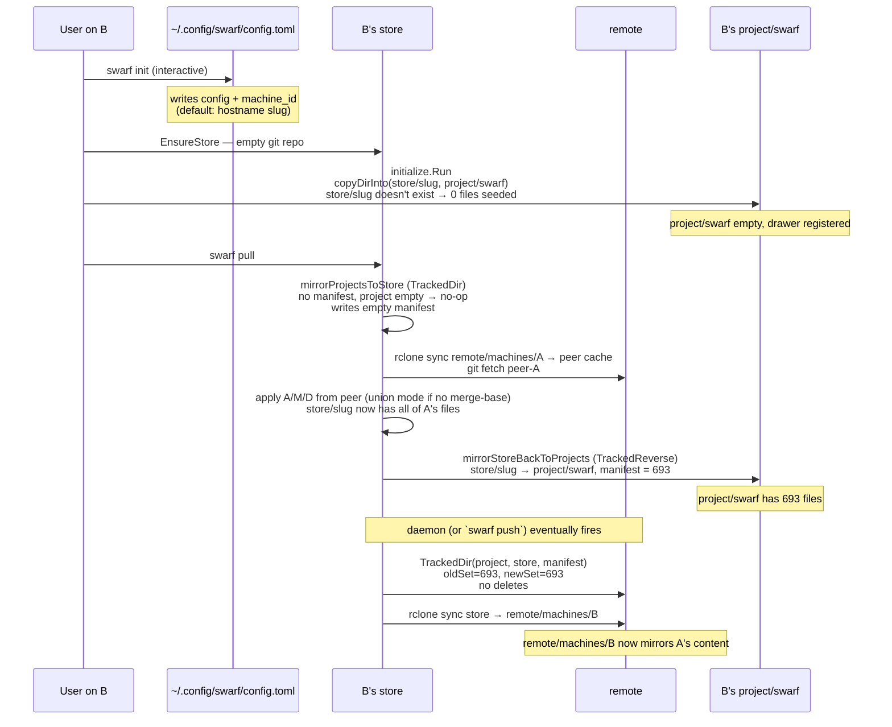

**Currently:** ✅ on paper — every step in the trace above lands the
right way given the post-`70fc2ea` code. Specifically:

- The `TrackedDir` on pull's forward mirror sees an absent manifest
  and short-circuits to "no deletes."
- After reverse mirror lands files in the project, it rewrites the
  manifest to the project's file set (693 files), so the next
  daemon/push cycle starts from what pull left behind and finds no
  deletes. (Before Sync Hardening task 2 the manifest stayed empty until
  that cycle recorded the full set; the outcome was the same.)
- Backend `Sync` pushes to `remote/machines/<self_id>/` — A's subtree
  is never touched.

**What could still go wrong (worth pinning down):**
- **Same `machine_id` on both computers.** `DefaultMachineID()` slugs
  the hostname. If both machines happen to share a hostname (e.g.
  generic `macbook` defaults), they collide. ✅ Now protected by the
  owner token (Sync Hardening task 5): each store keeps a random token
  in `.git/swarf-owner`, and before uploading the rclone backend reads
  the token already in `<remote>/machines/<machine_id>/`. A different
  store's token means the push commits locally and refuses to upload;
  an unreadable one skips the upload for that pass. `swarf doctor`
  reports the mismatch, and `swarf push --take-over` uploads anyway for
  a machine that genuinely replaces the old one. Locked in by
  `TestMultiMachine_SharedMachineIDRefusesSecondPush`, the
  `internal/daemon/backends/owner_test.go` suite, and
  `TestCheckMachineOwner`.
- **Daemon not running on B.** Init offers the service install but a
  user on a fresh second computer who declines / hasn't been root /
  is in a non-systemd container won't have a daemon. `swarf pull`
  alone leaves the store correct; `remote/machines/B` is *not*
  populated until something pushes. If the user expects pull to also
  push back, this looks like "wiped" because B's remote subtree is
  empty even after pull. (Still true: pull never pushes. With a daemon,
  `[sync] pull_interval` now makes pulling automatic as well.)
- **Project/swarf existed before init.** If the project dir already
  had stale content from an earlier experiment, that content goes
  into the manifest on first pass. Subsequent cycles where it's
  removed look like deletions and get applied to the store —
  Scenario 6.
- **An out-of-date binary on one of the two machines.** Pre-`70fc2ea`
  push uses the destructive `mirror.Dir` path and will wipe a store
  populated by pull. Worth confirming both binaries are post-fix.

**Suggested next step:** add an integration test that mirrors the
*exact* user-reported flow (init then pull on a fresh machine, with
the daemon not running, then run `swarf push` once to confirm B's
remote subtree gets populated without affecting A's). The
`machine_id` collision check landed as the owner token rather than a
`listPeers` comparison, since a shared id never shows up as a peer.
`TestMultiMachine_FreshMachineBootstrapsViaPull` and
`TestMultiMachine_WipedProjectHoldsDeletes` cover most of the flow but
do not assert A's subtree is untouched.

## Verification matrix

| # | Scenario | Status | Test |
|---|----------|--------|------|
| 1 | Edit propagates | ✅ | daemon path; `TestMultiMachine_RoundTrip` |
| 2 | Delete propagates | ✅ | `TestMultiMachine_DeletePropagates` |
| 3 | First run, empty | ✅ | `TestMultiMachine_EmptyProjectDoesNotWipeStore` |
| 4 | Pull peer files | ✅ | `TestMultiMachine_AEditsPushes_BInits` etc; `TestMultiMachine_FileSavedDuringPullSurvives` |
| 5 | Daemon vs pull race | ✅ sync lock | `TestMultiMachine_PushWaitsForRunningPull`, `TestMultiMachine_PullWaitsForRunningPush`, `TestSyncCycleWaitsForSyncLock` |
| 6 | Project wipe → store wipe | ✅ delete hold | `TestMultiMachine_WipedProjectHoldsDeletes`, `TestMultiMachine_AllowDeletesAppliesHeldDeletes` |
| 7 | Pull's forward clobbers (stale manifest) | ✅ delete hold | `TestMultiMachine_WipedProjectHoldsDeletes` (pull from a wiped project) |
| 8 | rm -rf swarf/ | ✅ | `TestTrackedDirHoldsWhenProjectLosesEveryFile` |
| 9 | Cross-machine conflict | ✅ | `TestPullMultiPeerConflict`, `TestMultiMachine_ConflictingEdits` |
| 10 | Retired peer | ⚠️ out of scope | none |
| 11 | Manifest corruption | ✅ defensive | none — should add |
| 12 | Second-computer bootstrap | ✅; shared `machine_id` refused | `TestMultiMachine_FreshMachineBootstrapsViaPull`, `TestMultiMachine_SharedMachineIDRefusesSecondPush` |
| — | Store already lost files | ✅ `swarf pull --resync` | `TestMultiMachine_ResyncRestoresDivergedStore`, `TestPullResync*` |
| — | Scheduled pull | ✅ `[sync] pull_interval` | `TestMultiMachine_DaemonScheduledPull`, `TestMultiMachine_DaemonScheduledPullGitBackendNote`, `TestPullSchedule` |

## Proposed work, in priority order

Done in [Sync Hardening](SYNC_HARDENING.md):

- ~~**Remove `mirrorProjectsToStore()` from `pullRclone`**~~ —
  **withdrawn**: without pull's forward mirror, the reverse mirror would
  delete a file saved just before the pull (see Scenario 7). The forward
  mirror stays; the delete hold makes it safe.
- ✅ **Mass-delete sanity guard in `TrackedDir`** — the delete hold
  (task 1), surfaced by `swarf status` and `swarf doctor`.
- ✅ **Reverse mirror deletes only what it has seen synced** (task 2).
- ✅ **Recovery for a store that already lost files** —
  `swarf pull --resync` (task 3).
- ✅ **Daemon-vs-pull race** (Scenario 5) — the sync lock (task 4),
  with integration tests that run a push and a pull against each other.
- ✅ **Scheduled pull** — `[sync] pull_interval` (task 4).
- ✅ **`machine_id` collision** — the owner token, `swarf doctor`'s
  "machine owner" check, and `swarf push --take-over` (task 5).

Still open:

1. **Integration test for Scenario 12.** The exact user-reported
   second-computer flow, end-to-end, asserting A's subtree is untouched.
2. **Peer decommission UX** (Scenario 10). `swarf forget-peer <id>`
   that drops `refs/swarf-peers/<id>` and prompts the user to delete
   the remote subtree.
3. **Manifest-corruption regression tests** (Scenario 11). Pin down
   the defensive behavior.
4. **Reinstalled machine under its old `machine_id`.** Pull skips its
   own id, so it never pulls its old subtree back; other peers still
   have the data.
